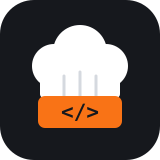

<p align="center">
  
</p>

<h1 align="center">CookCode</h1>

<p align="center">
  <strong>A coding agent harness built from scratch around a replayable event log.</strong><br>
  Every request the model saw can be rebuilt byte for byte, every run can be resumed, forked and replayed, and every design claim has a measurement behind it.
</p>

<p align="center">
  <a href="https://github.com/abhilash2429/CookCode/actions/workflows/ci.yml"></a>
  
  
  
  
  
</p>

<p align="center">
  <a href="#quickstart">Quickstart</a> ·
  <a href="#features">Features</a> ·
  <a href="#results">Results</a> ·
  <a href="#configuration">Configuration</a> ·
  <a href="#evaluation">Evaluation</a> ·
  <a href="#architecture">Architecture</a> ·
  <a href="docs/decisions/">Design decisions</a>
</p>

---

## Why CookCode

Most agent harnesses are hard to reason about after the fact: the prompt was assembled from mutable state, retries happened somewhere in a client library, and a crash mid-tool-call leaves no record of what ran. CookCode takes the opposite position.

- **The log is the source of truth.** Every model request, streamed item, tool call, approval and retry is an event in an append-only JSONL log. The context builder is a pure function of that log.
- **Replay is exact.** `cookcode replay <session>` rebuilds every request from the log and checks its items hash. Suite cassettes replay whole agent runs offline in seconds.
- **Crashes are boring.** A crash mid-tool-call is repaired on resume: read-only calls rerun, and mutating calls are reported as `unknown` so the model decides.
- **Decisions are written down.** 50 decision records explain what was chosen, what was rejected, and what would change the call.

## Quickstart

CookCode needs Python 3.12+ and [uv](https://docs.astral.sh/uv/). It runs on Linux and WSL.

```bash
git clone https://github.com/abhilash2429/CookCode.git
cd CookCode
uv sync
```

Set a key for a provider. NVIDIA NIM is the default:

```bash
export NVIDIA_API_KEY=...        # or GEMINI_API_KEY with --provider gemini,
                                 # or OPENROUTER_API_KEY with --provider openrouter
```

Run it inside any git repository:

```bash
uv run cookcode                              # interactive
uv run cookcode --tui                        # full-screen client (extra: tui)
uv run cookcode --once "fix the failing test in tests/test_dates.py"
uv run cookcode -p "summarize this repo" --json   # headless, one JSON event per line
```

Useful flags: `--model`, `--mode ask|auto-edit|yolo`, `--max-turns`, `--strategy`, `--features`.

## Features

| | |
|---|---|
| **Event-sourced core** | Append-only log with torn-tail recovery, redaction at write time and additive schema evolution (`cookcode schema`). |
| **Sessions** | `sessions`, `resume`, `fork --at SEQ`, `replay` and `export` (ATIF). Switch providers mid-session: reasoning that can't be replayed is dropped and counted. |
| **Tools** | read, write, edit, glob, grep and bash, with snapshots and undo, a permission gate (`ask`, `auto-edit`, `yolo`) and allow and deny rules. |
| **Providers** | NVIDIA NIM, OpenRouter (OpenAI-compatible) and native Gemini with thought-signature replay, on one streaming transport with logged retries and a 429 wait budget. |
| **Context strategies** | `raw`, `mask`, `mask_batched`, `summarize`, `hybrid`. Masked outputs come back through `recall`, and summaries are logged so replay never calls a model. |
| **Background jobs** | `job_start` and `job_check` for commands that outlive the bash timeout, locally or in a container. |
| **Verify-first** | A hard lock: register a failing reproduction before changing existing files, and the stop hook reruns it before the turn can end. |
| **Memory** | A notes file, or atomic facts in SQLite FTS5 with file-hash provenance. Stale facts are hidden on read. |
| **Sub-agents** | A `task` tool runs a child agent in its own context. A hook enforces a four-section report. |
| **Skills** | `.cookcode/skills/<name>/SKILL.md`, listed by name and loaded on demand. |
| **Hooks** | Shell commands with the event as JSON on stdin. Exit 2 blocks, with the hook's output as the reason. |
| **MCP** | stdio MCP servers. Tool schemas are deferred and loaded through `tool_search`, and the loaded set is computed from the log. |
| **Harbor / Terminal-Bench** | `cookcode.harbor.agent:CookCodeAgent` runs the same loop inside task containers. |

Everything from background jobs down is behind a feature flag and off by default, so the measured baseline stays the measured baseline.

## Results

All numbers come from free-tier NVIDIA NIM (`minimaxai/minimax-m3.1-flash`), with 2 requests in flight per key.

**Terminal-Bench 2.0 slice** (10 tasks × 5 attempts, same endpoint, model and 50-turn cap for both agents):

| Agent | Score | 95% CI | Per-round spread |
|---|---|---|---|
| CookCode | **0.800** | 0.60 to 0.94 | 0.70 to 0.90 |
| Terminus 2 | 0.760 | 0.54 to 0.96 | 0.50 to 0.90 |

The 0.04 gap is below the paired minimum detectable effect (about 0.20), so the two agents are statistically indistinguishable on this slice. Method: [0036](docs/decisions/0036-terminal-bench-slice-and-protocol.md), [0037](docs/decisions/0037-stats-and-variance-method.md).

**Context strategies** (counterfactual over the same 50 trajectories, 794 requests, no API calls):

| Strategy | Input tokens | Uncached tokens | Effective input (cache reads at 10%) |
|---|---|---|---|
| `raw` | 19.6M | 1.32M | 3.14M |
| `mask:k6` | 11.8M (−40%) | 4.41M | 5.15M |
| `mask_batched:k6:b8` | 13.8M (−30%) | 1.89M | **3.08M** |

Plain masking cuts tokens and breaks the prompt cache, so it costs more than doing nothing. Batched masking keeps most of the saving at a fraction of the cache loss. See [0038](docs/decisions/0038-context-strategies.md) and [0039](docs/decisions/0039-token-ledger-and-counterfactual.md).

**Feature ablations** (local suite, live, attempts lost to the provider re-run):

| Feature | Result |
|---|---|
| Verify-first | Same pass rate (12/12), +50% input tokens. 12/12 reproductions failed for the right reason. |
| Memory: notes | Same pass rate on the follow-up tasks, about a third fewer input tokens. |
| Memory: facts | No measurable change. The paired tasks were too easy to need memory. |
| Sub-agents | Offered in every run, never called on tasks averaging 7 turns. |
| Jobs | The mechanism works, but the model polled with `bash` instead of `job_check`. |

Full numbers and caveats are in [0036](docs/decisions/0036-terminal-bench-slice-and-protocol.md#final-results-2026-10-29).

Over 74 measured sessions, the agent produced zero repeat streaks (3 or more identical call-and-result pairs in a row), so no stuck-loop breaker was built ([0014](docs/decisions/0014-stuck-loop-rule.md)).

## Configuration

Settings live in `~/.local/share/cookcode/settings.toml` (user) and `.cookcode/settings.toml` (repository):

```toml
provider = "nim"
model = "minimaxai/minimax-m3.1-flash"
mode = "auto-edit"
max_turns = 40
strategy = "mask_batched:k6:b8"
features = "jobs,verify_first,skills,hooks,mcp"
allow = ["bash:pytest *"]
deny = ["bash:rm -rf *"]

[[hooks]]
point = "pre_tool"           # or "stop"
match = "write|edit"
command = "python3 scripts/guard.py"

[mcp.servers.docs]
command = "npx"
args = ["-y", "some-mcp-server"]
```

Precedence, highest first: flag, resumed session, `COOKCODE_*` environment, repository, user, built-in preset. Rules and hooks add up across files, and deny wins. Hooks and MCP servers run commands, so they stay inert until their feature is enabled ([0047](docs/decisions/0047-settings-and-precedence.md)).

| Feature | Flag | Decision |
|---|---|---|
| Background jobs | `jobs` | [0040](docs/decisions/0040-background-jobs.md) |
| Verify-first | `verify_first` | [0041](docs/decisions/0041-hooks-and-verify-first.md) |
| Memory | `notes`, `facts` | [0042](docs/decisions/0042-memory-store-and-staleness.md) |
| Sub-agents | `subagents` | [0044](docs/decisions/0044-sub-agent-contract.md) |
| Skills | `skills` | [0045](docs/decisions/0045-skills.md) |
| User hooks | `hooks` | [0046](docs/decisions/0046-user-hook-api.md) |
| MCP | `mcp` | [0048](docs/decisions/0048-mcp-deferred-schemas.md) |

## Evaluation

CookCode ships its own measurement stack. Everything except `live` and `record` mode runs offline.

```bash
uv run cookcode eval run                                  # replay 36 suite tasks from cassettes
uv run cookcode eval run --mode oracle                    # run the reference solutions
uv run cookcode eval run --mode live --attempts 3 --strategy hybrid --features verify_first
uv run cookcode eval report <run-dir | harbor-job ...>    # score, bootstrap CI, paired MDE
uv run cookcode eval context <dirs> --strategies raw,mask:k6,mask_batched:k6:b8
uv run cookcode eval repro <run-dir>                      # did reproductions fail for the right reason?
uv run cookcode stats <session | dir>                     # tokens, cache share, time split, tool errors
```

- **Local suite:** 24 tasks (bugfix, feature, refactor, investigate) plus 6 memory pairs, with hidden checks, oracle solutions and sequenced cassettes ([0035](docs/decisions/0035-local-suite-and-sequenced-cassettes.md), [0043](docs/decisions/0043-memory-pair-tasks.md)).
- **Terminal-Bench:** `evals/run_tb.sh cookcode|terminus-2 <attempts> [task ...]` runs the fixed slice against either agent. Docker is required.
- **Honest scoring:** attempts lost to provider outages are excluded and named, never scored as failures.

## Architecture

```
src/cookcode/
  core/        events, items, cancellation, strategies, feature flags
  store/       append-only session log with torn-tail recovery
  agent/       the step loop, context builder, tool registry, approval gate, hooks
  providers/   streaming transport, OpenAI-compatible and Gemini codecs, cassettes
  tools/       file tools, search, bash, jobs, verify-first, recall
  memory/      fact store and memory layer
  env/         local and Harbor environments behind one exec interface
  cli/         plain CLI, headless mode, TUI, session commands
  evals/       suite runner, stats, variance, counterfactual, repro judge
  export/      ATIF projection
  harbor/      Terminal-Bench agent adapter
  chaos/       fault injection for the crash-safety tests
  kit.py       composes tools, hooks and prompt additions from strategy and features
  subagents.py, skills.py, userhooks.py, mcp.py, config.py, redact.py
```

The agent package never imports concrete tools, and the tools see only a narrow contract. An import-boundary test enforces both. Every client (CLI, TUI, headless, Harbor) observes the same runtime.

## Documentation

- [Design spec](docs/specs/2026-10-22-flagship1-design.md) and [visual overview](docs/blueprint.html)
- [Decision records](docs/decisions/): 0001 to 0050
- [Walkthroughs](docs/walkthroughs/): one per milestone (M0 to M10), each with cross-questions
- [Event schema](docs/schema/events-v1.json)

## Development

```bash
uv sync
uv run pytest -q                 # 1026 tests, about 30 s
uv run pyright src tests         # strict
uv run ruff check src tests
```

Provider tests replay recorded traffic from `tests/cassettes/`. To re-record one adapter:

```bash
COOKCODE_RECORD=1 uv run pytest tests/test_cassettes.py -k nim
```

## Status

CookCode is a portfolio project, built milestone by milestone, with each milestone gated on decision records, a walkthrough and passing acceptance runs. It is not packaged for PyPI.
